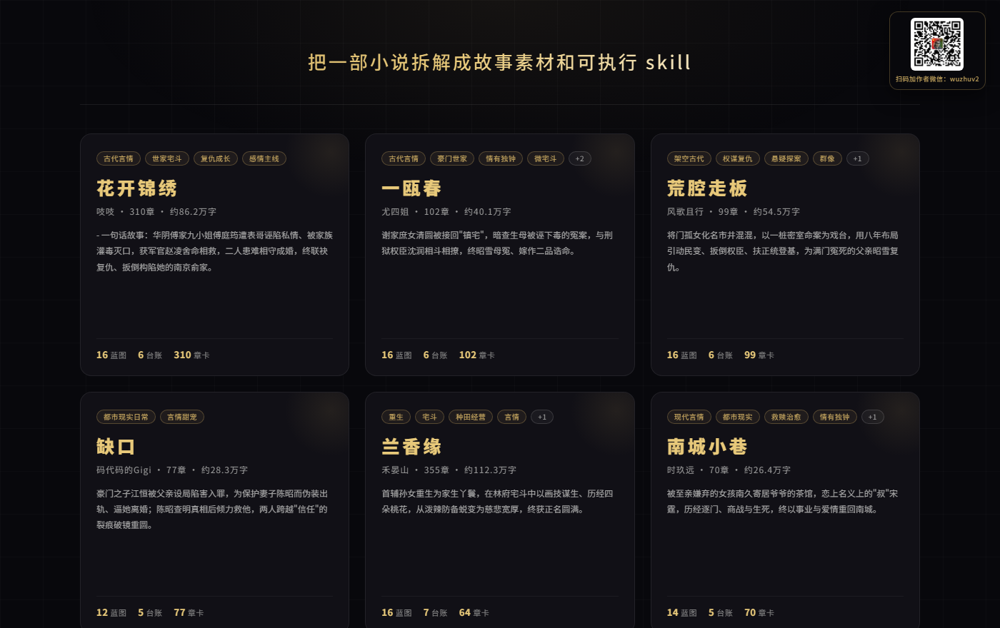
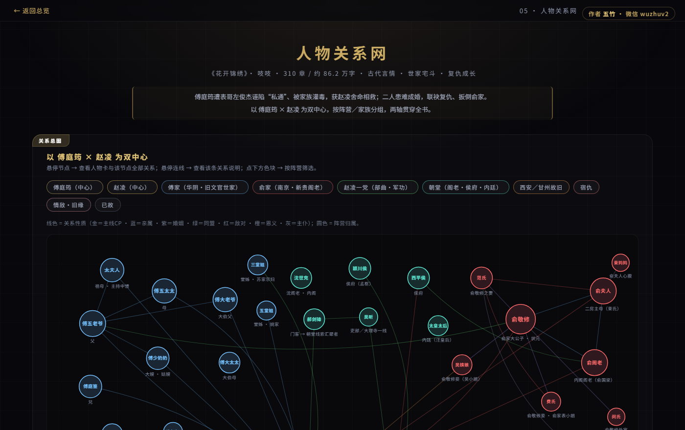

# 小说拆解书架 · Novel Teardown Shelf

> 把一部小说拆解成故事素材和可执行 skill

**在线预览 →** https://newbiefly.github.io/novel-teardown-shelf/

98 个页面 · 6 本书 · 90 张创作蓝图 · 纯静态无依赖



本仓库不是代码项目，是一个**拆解产物展馆**：每一本小说都被逆向拆成一份「创作蓝图」——故事概要、人物弧光、关系网、情绪曲线、伏笔规划、阵营博弈、力量体系、意象符号等维度，全部带章节锚点，可回溯核对。

---

## 在线预览

- **在线**：https://newbiefly.github.io/novel-teardown-shelf/ （GitHub Pages）
- **本地**：直接双击 `index.html` 即可，无需构建、无需起服务、无外部依赖，断网也能看

---

## 书架清单

| 书名 | 作者 | 体量 | 题材 | 蓝图 | 一句话 |
|---|---|---|---|---|---|
| 花开锦绣 | 吱吱 | 310章 / 86.2万字 | 古代言情 · 世家宅斗 · 复仇成长 | 16 | 华阴傅家九小姐傅庭筠遭表哥诬陷私情、被家族灌毒灭口，获军官赵凌舍命相救，二人患难相守成婚，终联袂复仇、扳倒构陷她的南京俞家。 |
| 一瓯春 | 尤四姐 | 102章 / 40.1万字 | 古代言情 · 豪门世家 · 微宅斗 | 16 | 谢家庶女清圆被接回"镇宅"，暗查生母被诬下毒的冤案，与刑狱权臣沈润相斗相撩，终昭雪母冤、嫁作二品诰命。 |
| 荒腔走板 | 风歌且行 | 99章 / 54.5万字 | 架空古代 · 权谋复仇 · 悬疑探案 · 群像 | 16 | 将门孤女化名市井混混，以一桩密室命案为戏台，用八年布局引动民变、扳倒权臣、扶正统登基，为满门冤死的父亲昭雪复仇。 |
| 缺口 | 码代码的Gigi | 77章 / 28.3万字 | 都市现实日常 · 言情甜宠 | 12 | 豪门之子江恒被父亲设局陷害入罪，为保护妻子陈昭而伪装出轨、逼她离婚；陈昭查明真相后倾力救他，两人跨越"信任"的裂痕破镜重圆。 |
| 兰香缘 | 禾晏山 | 355章 / 112.3万字 | 重生 · 宅斗 · 种田经营 · 言情 · 权谋 | 16 | 首辅孙女重生为家生丫鬟，在林府宅斗中以画技谋生、历经四朵桃花，从泼辣防备蜕变为慈悲宽厚，终获正名圆满。 |
| 南城小巷 | 时玖远 | 70章 / 26.4万字 | 现代言情 · 都市现实 · 救赎治愈 | 14 | 被至亲嫌弃的女孩南久寄居爷爷的茶馆，恋上名义上的"叔"宋霆，历经逐门、商战与生死，终以事业与爱情重回南城。 |

---

## 每本书里有什么

蓝图维度**按题材选配**，不是固定套模板——所以 6 本书的维度数量和组合都不完全一样（12～16 张）。例如：

- **花开锦绣**（权谋+群像）：人物关系网 · 阵营博弈 · 力量体系 · 视角分配 · 谜题与诡计 · 支线地图 · 脱敏谋生线
- **缺口**（都市双时间线）：故事概要 · 核心设定 · 人物设定集 · 关系网 · 分卷大纲 · 时间线 · 意象符号

多数维度是**手工重构的可视化页面**而非纯文字，例如关系网做成可悬停的图谱、情绪曲线做成带★强度标记的折线、时间线做成双轨对照+信息差矩阵：



> 上图：《花开锦绣》人物关系网。节点按阵营着色，连线区分亲缘/婚配/仇怨/主仆/同盟，悬停可看人物卡片。

---

## 这些蓝图是怎么拆出来的

拆解分八步，核心原则是**「不是读后感，是逆向工程」**——每条结论都必须能回溯到具体章节。

| 步骤 | 做什么 |
|---|---|
| 1 · 提取切章 | epub/pdf → 逐章 txt，脚本精确统计字数 |
| 2 · 逐章拆解 | 一章一张章卡（超长篇走「情节单元」成卡）；同步滚动人物/伏笔/时间线/关系四本台账 |
| 3 · 逆向蓝图 | 从章卡+台账横向归纳成 N 个创作蓝图维度，并生成浏览页 |
| 4 · 蒸馏创作 skill | 把蓝图提炼成可执行的创作方法论（学/续/改/造四种用法） |
| 5 · 验收 | 用 skill 试写续写，检查是否崩人设、违设定 |
| 6 · 产品图 | 生成 3:4 信息图海报 |
| 7 · 打包 | 嵌套打包 skill + 浏览页（过滤原文） |
| 8 · 上架 | 汇入书架，出总入口 |

流程由 `novel-teardown-skill` 驱动，配置、字段、维度按每本书的题材单独确认后落盘。

---

## 目录结构

```
.
├── index.html              书架首页（书籍卡片网格）
├── docs/                   README 配图
├── 花开锦绣/
│   ├── index.html          该书总入口（蓝图 / SKILL 两个 Tab）
│   └── 蓝图/               16 张蓝图详情页
├── 一瓯春/     ├── index.html + 蓝图/（16 张）
├── 荒腔走板/   ├── index.html + 蓝图/（16 张）
├── 缺口/       ├── index.html + 蓝图/（12 张）
├── 兰香缘/     ├── index.html + 蓝图/（16 张）
├── 南城小巷/   ├── index.html + 蓝图/（14 张）
└── qrcode.jpg
```

每本书的**完整拆解数据**（章卡、台账、蓝图源文件、创作 skill 包）不在本仓库内，体积更大且含更多原文引用，故仓库只保留蓝图层。

---

## 自己拆一本

流程由 skill 驱动，脚本可单独调用：

```bash
S=.workbuddy/skills/novel-teardown-skill/scripts

# ① 提取原文并切成真实章回
node $S/extract-epub.js   <书.epub>  <书根>/_raw
node $S/split-chapters.js <书根>/_raw  <书根>/原文  25000

# ② 生成浏览页
node $S/md-to-html.js       <书根>/拆解数据/蓝图  <书根>/浏览/蓝图
node $S/build-chapter-viewer.js <书根>/拆解数据   <书根>/浏览
node $S/build-index.js       <书根>

# ③ 汇入书架（支持逗号分隔多个拆解区根）
python $S/assemble-shelf.py "<拆解区根>" <书架目录>
```

> 章节命名不是"第X章"的书（如分卷重排、章号与章名分两行）需要自行调整切章正则，详见 skill 内 `references/`。

---

## 说明

- **本仓库不含任何小说原文**，只包含分析性产物与可视化页面。所有作品的著作权与文字权利归原作者及出版方所有。
- 这里的拆解仅供写作学习与技术研究之用。
- 书封与版权信息归原出版社及作者；如权利人认为不合适，请联系删除对应书目。

---

作者：五竹 · 拆解流程由 `novel-teardown-skill` 驱动